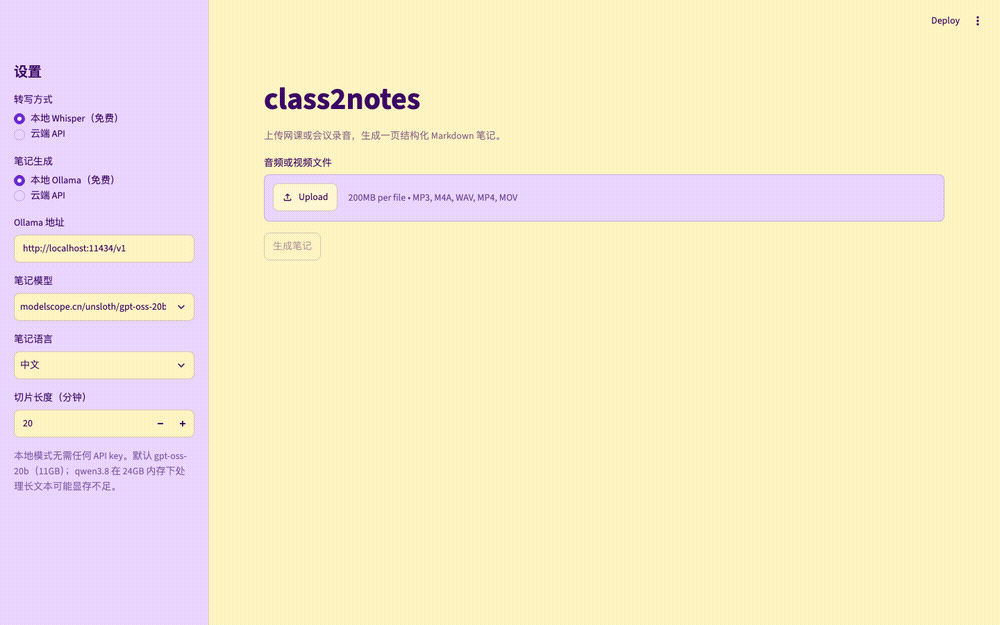

# class2notes

把网课/会议录音变成一页结构化 Markdown 学习笔记。默认全程本地运行，音频不出本机，不需要任何 API key。

Upload a lecture or meeting recording and get a one-page structured Markdown note. Runs fully locally by default (Ollama + mlx-whisper).



## 它能做什么

- 输入 `mp3` / `m4a` / `wav` / `mp4` 单个文件
- 输出固定四段笔记：一句话总结、核心要点、术语表、带时间戳的完整转写
- 本地 Whisper 转写 + 本地 Ollama 生成，或切换到任意 OpenAI 兼容的云端服务
- 网页上直接看，一键下载 `.md`

## 快速开始（本地模式，无需 API key）

环境要求：

- macOS + Apple Silicon（本地转写依赖 mlx-whisper，Intel Mac 不可用）
- 内存 16GB 以上（默认模型 11GB，转写时还要额外加载 Whisper）
- Python 3.10+、[Ollama](https://ollama.com)、ffmpeg
- Windows / Linux：本地转写不可用，请把"转写方式"和"笔记生成"都切到"云端 API"，
  分别填写一个支持 `/audio/transcriptions` 的服务和一个对话模型服务

如果侧边栏默认模型和 `ollama list` 里的名字对不上，选"自定义"填你本地实际的模型名，
或在 `.env` 里设置 `OLLAMA_MODEL`。

### 1. 安装系统依赖

```bash
brew install ffmpeg
```

### 2. 安装依赖

```bash
git clone <this-repo>
cd class2notes
python3.11 -m venv .venv
source .venv/bin/activate
pip install -r requirements.txt
```

### 3. 准备本地模型

```bash
# 推荐：11GB，24GB 内存可以流畅运行
ollama pull gpt-oss:20b

# 可选：更大的模型，按你本地实际安装的名称填写
# 本机实测为 qwen3.8:latest（27.8B / 18GB），短文本质量更好，
# 但长转写在 24GB 内存上会显存不足
```

Ollama 默认上下文只有 4096，必须调大，否则长转写会被静默截断：

```bash
launchctl setenv OLLAMA_CONTEXT_LENGTH 8192
# 完全退出 Ollama 后重新打开；若 context 仍是 4096，先执行 pkill -f 'ollama serve'
ollama ps   # 加载模型后确认 CONTEXT 为 8192
```

国内网络首次下载 Whisper 模型需要镜像：

```bash
export HF_ENDPOINT=https://hf-mirror.com
```

### 4. 启动

```bash
streamlit run app.py
```

打开 <http://localhost:8501>，上传音频，点"生成笔记"。

首次运行会自动下载 Whisper 模型（约 1.6GB），之后可完全离线。

## 选择哪个本地模型

| 模型 | 体积 | 建议 |
|---|---|---|
| `gpt-oss:20b` | 11GB | 默认，24GB 内存稳定运行 |
| `deepseek:latest`（R1-8B） | 5GB | 内存紧张时用，中文尚可但速度较慢 |
| `qwen3.8:latest`（27.8B） | 18GB | 短文本质量好；长转写在 24GB 内存上会显存不足 |

模型名可在侧边栏选择或手动填写，任何 Ollama 已安装的模型都能用。

## 可选：使用云端 API

侧边栏把"转写方式"或"笔记生成"切到"云端 API"，填入：

- Base URL：任意 OpenAI 兼容地址（OpenAI、硅基流动、通义等）
- API Key：只保存在当前会话，不写入磁盘
- 模型名：2026-11 在硅基流动实测可用的组合是
  `XingChenAGI/XingChenASR-V3.2-Ultra`（转写）和 `Qwen/Qwen3.5-9B`（笔记）。
  原先常见的 `FunAudioLLM/SenseVoiceSmall` 已从该平台下架。

云端按厂商价格计费，通常一小时课程在几毛钱以内。转写接口不返回分段时，
程序会自动降级为整段文本，不会报错。如果报 `402`，通常是账户余额不足。

### 混用不同厂商：本地转写 + DeepSeek 出笔记

DeepSeek 目前只有文本模型（`deepseek-chat`、`deepseek-reasoner`），**没有语音转写接口**，
所以推荐这样组合：

- 转写方式：`本地 Whisper（免费）`
- 笔记生成：`云端 API`
- 笔记 Base URL：`https://api.deepseek.com`
- 笔记模型：`deepseek-chat`
- 笔记 API Key：DeepSeek 平台生成的 key

转写和笔记的地址、密钥是完全独立的，也可以反过来：云端转写 + 本地 Ollama 出笔记。
实测 2436 字转写交给 `deepseek-chat`，5 秒出四段笔记，比本地 11GB 模型快一个数量级。

## 工作原理

```
音频/视频
   ↓ ffmpeg 抽音轨（16kHz 单声道）
   ↓ 按 20 分钟切片
   ↓ 静音检测（整片无声直接提示）
   ↓ Whisper 转写（本地 mlx-whisper / 云端 API）
   ↓ 合并成段落（170 条碎片 → 10 段）
   ↓ 大模型按四段模板生成笔记（长文 map-reduce）
   ↓ Markdown 组装 + 下载
```

## 实测数据（M 系列 Mac，24GB）

| 项目 | 结果 |
|---|---|
| 7.2 分钟中文会议录音 | 转写 2 分 47 秒（170 句），生成笔记 58 秒 |
| 90 秒录音（云端，硅基流动） | 转写 19.8 秒，生成笔记 168 秒 |
| 2436 字转写 → DeepSeek 笔记 | **5 秒**（本地 Whisper 转写 + 云端出笔记，界面实测） |
| 输出 | 四段齐全，10 个主题要点，10 条术语 |
| 成本 | 本地模式 0 元；云端按厂商价格计费 |

## 设计取舍

- **为什么本地优先**：会议和课堂内容敏感，音频不出本机是这类工具最有价值的部分，也省掉了账号、密钥和服务器。
- **为什么切片 20 分钟**：云端 ASR 有单文件大小限制；本地切片也让进度可见、失败可续。
- **为什么先合并句子再给模型**：Whisper 的原始分段平均 2–3 秒一条，直接喂给模型会得到碎片化要点；合并成段落后再总结，主题归纳明显更好。
- **为什么笔记只有四段**：选项越少，输出越稳定，也更容易一眼读完。
- **为什么不用最大模型**：18GB 的 27B 模型在 24GB 机器上处理长文本会触发 Metal 显存不足，可用性优先于纸面参数。

## 已知限制

- 没有说话人分离：多人会议不会标注"谁说的"
- 转写会有同音字和专有名词错误，笔记可能继承这些错误
- 不支持实时字幕，需等录音文件生成后处理
- 首次运行需要联网下载模型

## Roadmap

- **v0.2 实时字幕**：Chrome 扩展抓取标签页音频，字幕浮层实时翻译，会后自动生成笔记
- 自定义笔记模板（面试记录、需求评审、课堂复习）
- 说话人分离
- 批量处理

## 开发

```bash
pytest -q   # 20 个测试
```

```
app.py         Streamlit 界面与流程编排
audio.py       ffmpeg 抽轨、切片、静音检测
transcribe.py  云端 ASR、时间戳合并、段落合并
asr_local.py   本地 mlx-whisper 转写
notes.py       笔记生成（单次 / map-reduce）与 Markdown 组装
prompts.py     提示词
```

## 隐私

本地模式：音频和文本只在本机处理，不发送到任何服务器。
云端模式：只发送到你配置的服务商。

## License

MIT
